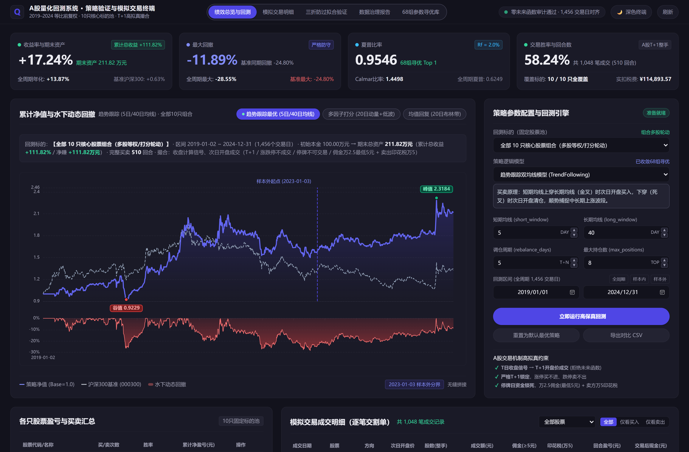
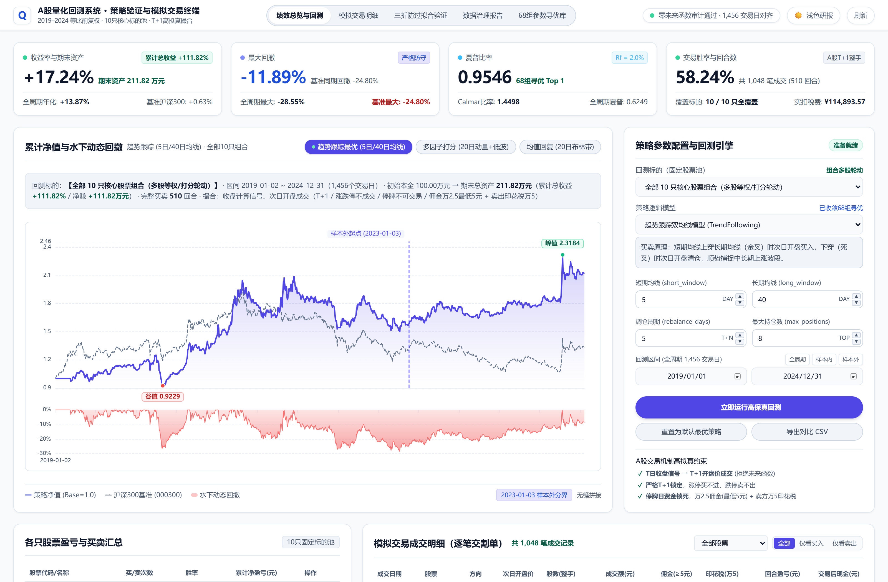
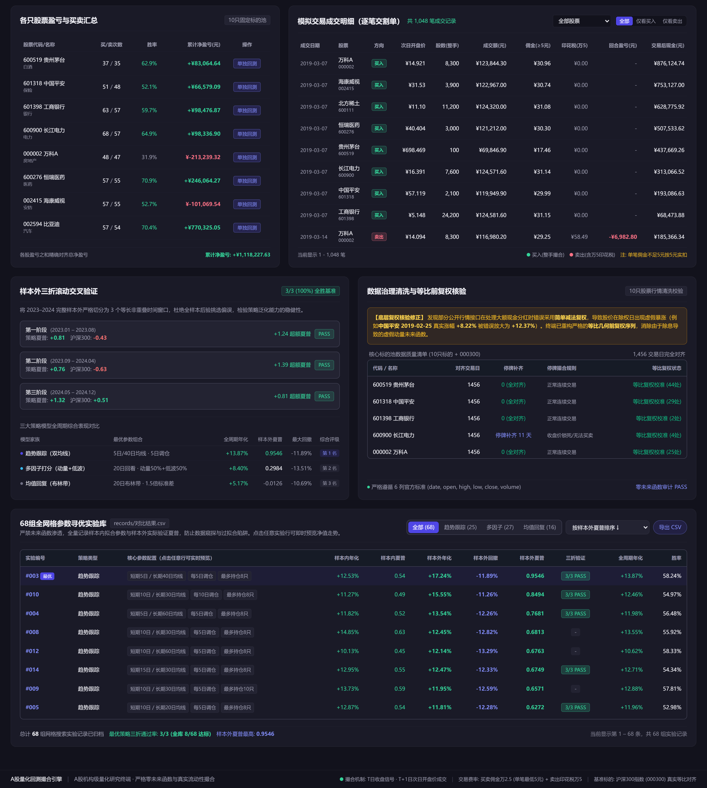
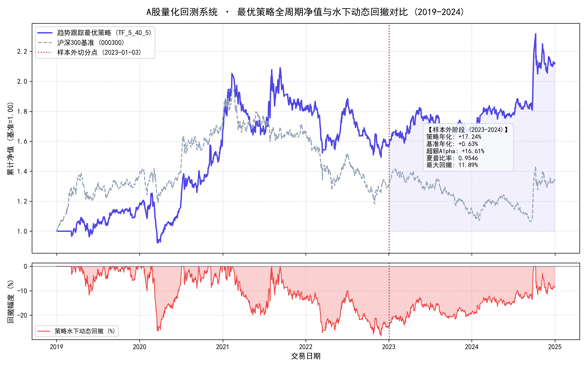
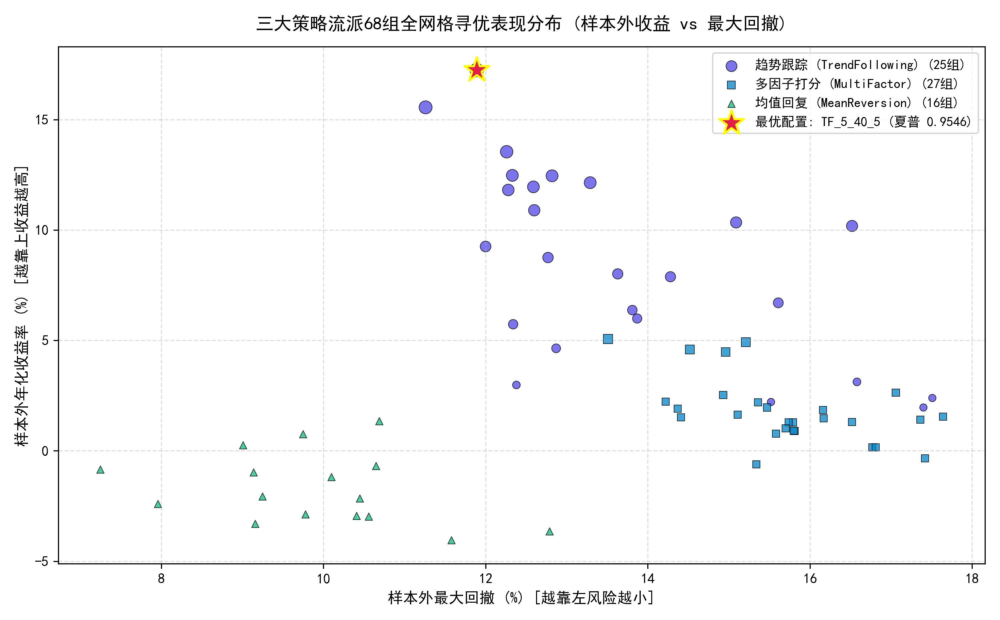
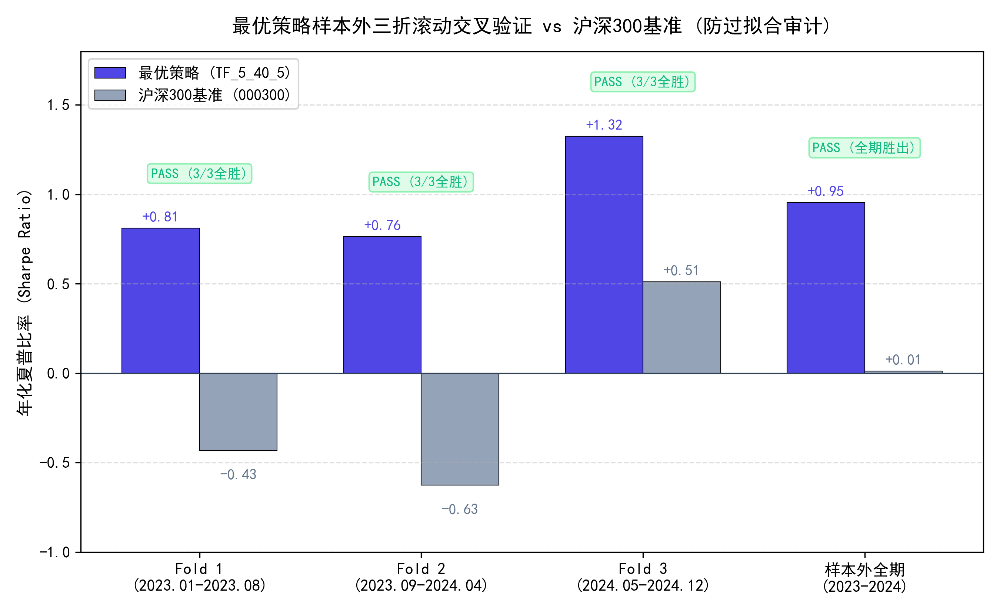

<div align="center">

# A股量化回测与策略验证系统

**2019–2024 等比前复权日线数据治理 · T+1 高拟真微观撮合引擎 · 组合/单股交互回测与样本外三折防过拟合验证**


[快速开始](#快速开始-quickstart) · [核心功能](#核心功能) · [界面与交割账本预览](#界面与交割账本预览) · [系统架构与目录结构](#系统架构与目录结构) · [策略评估与防过拟合验证](#策略评估与防过拟合验证) · [工程质量验证](#工程质量验证)

</div>

---

## 快速开始 (Quickstart)

### 第一步：获取项目源码并解压（二选一）

**方式 A（下载 ZIP 压缩包，推荐新手）**

1. 打开 GitHub 仓库页面，点击右上角绿色 **`Code`** 按钮；
2. 选择 **`Download ZIP`** 下载压缩包；
3. **将压缩包解压到本地任意目录**（例如 `D:\Quant-Backtest-Terminal`），进入解压后的文件夹，确认当前目录下可以直接看到 **`app.py`** 与 **`启动.bat`**。

**方式 B（Git 克隆）**

```bash
git clone https://github.com/lifelinezzz90-cmd/Quant-Backtest-Terminal.git
cd Quant-Backtest-Terminal
```

### 第二步：配置 Python 环境与安装依赖（新设备首次运行必做）

本项目支持 **Python 3.8 ~ 3.12**（推荐使用 Miniforge 或 Miniconda 管理虚拟环境）。仓库已内置 10 只核心 A 股与沪深300基准完整日线数据（2019–2024）及本地离线前端静态库（ECharts 5 / Tailwind CSS），**安装完 Python 依赖即可 100% 离线运行，无需配置任何外部数据源或 CDN。**

在解压后的项目文件夹内打开终端（Miniforge Prompt、CMD 或 PowerShell），依次执行：

```bash
# 1. 创建并激活名为 quant 的 Python 3.10 环境（若本机已有 Python 3.8~3.12 环境可跳过此步）
conda create -n quant python=3.10 -y
conda activate quant

# 2. 使用清华镜像源安装依赖包（numpy, pandas, matplotlib, flask, akshare）
pip install -r requirements.txt -i https://pypi.tuna.tsinghua.edu.cn/simple

# 3. 验证环境是否就绪（输出“环境 OK”即为成功）
python -c "import akshare, pandas, matplotlib, flask; print('环境 OK')"
```

### 第三步：启动回测系统（图形界面 / 命令行二选一）

**图形界面启动（Windows 一键双击）**：直接双击项目根目录下的 **`启动.bat`**（或在终端执行 `python app.py --mode web`），浏览器将自动打开 [http://127.0.0.1:5000](http://127.0.0.1:5000) 进入交互式回测终端。启动脚本会自动探测 Python/Conda 环境，并在数据或策略配置缺失时自动完成修复。

**命令行 (CLI) 批量运行模式**：统一入口 `app.py`，五种运行模式：

| 模式 | 命令示例 | 功能说明 |
|---|---|---|
| `web` | `python app.py --mode web --port 5000` | 启动本地 Flask 双主题交互回测终端（`--no-browser` 可禁止自动唤起浏览器） |
| `backtest` | `python app.py --mode backtest --strategy trend --params "{\"short_window\":5,\"long_window\":40}"` | 命令行单策略回测，支持 `--strategy` / `--params` / `--start` / `--end`，输出绩效指标与净值图 |
| `optimize` | `python app.py --mode optimize` | 68 组全网格参数寻优 + 样本外三折滚动验证，结果落盘 `records/对比结果.csv` |
| `validate` | `python app.py --mode validate --sample` | 数据清洗、异常修复与等比前复权校验流水线（`--sample` 为快速样例冒烟模式） |
| `test` | `python app.py --mode test` | 四重质量验真审计（防未来函数 / 会计恒等式 / 开盘价吻合 / 整手与非负现金），全部通过退出码为 0 |

## 核心功能

**1. 组合与单股双模式交互回测 + 逐笔交割账本**
支持「全部 10 只股票组合轮动」与「单只股票独立回测」两种模式一键切换；每笔回测输出逐笔交割账本（成交日期、次日开盘价、股数、成交额、佣金、印花税、回合净盈亏、交易后现金）与各股盈亏归因汇总，成交价保留前复权真实精度，`成交价 × 股数 == 成交额` 手工复算严丝合缝。

**2. A 股高拟真微观撮合引擎**
T 日收盘计算信号 → T+1 开盘价成交、T+1 持仓锁仓、±10% 涨跌停拒单（涨停拒买 / 跌停锁卖）、停牌资金锁死、100 股整手约束、挂单状态机次日自动补单；万 2.5 佣金（单笔最低 5 元）+ 卖出万 5 印花税实扣，账户现金全程非负。

**3. 数据质量治理与等比几何前复权校准**
修复公开行情接口「简单减法除息」导致的低价区间收益率虚假放大——以 601318 中国平安 2019-02-25 为例，真实涨幅 **+8.22%** 被减法复权误算为 **+12.37%**；本系统以等比缩放因子重构前复权序列，除权日前后持股收益率 100% 物理真实。

**4. 样本外切分、68 组网格寻优与三折防过拟合验证**
样本内（2019–2022）寻优、样本外（2023–2024）检验，趋势跟踪 / 均值回复 / 多因子三大策略家族共 68 组参数网格独立回测；样本外再切分三段非重叠时间窗口做滚动交叉验证，综合评分 `rank_score = 40% × 样本外夏普 + 20% × 样本内夏普 + 20% × 样本外卡玛 + 20% × 三折稳健通过奖惩项`，严防过拟合与风格飘移。

## 界面与交割账本预览

深色终端与浅色研报双主题一键切换，100% 离线渲染：

| 深色终端模式 | 浅色研报模式 |
|---|---|
|  |  |

中下屏审计区全景——各只股票盈亏与买卖汇总、逐笔模拟交易交割单、样本外三折验证与 68 组参数寻优实验库（实验编号与参数说明均为直观中文胶囊样式）：



## 系统架构与目录结构

数据流与撮合闭环：

```text
原始行情 (data/raw, 10只标的 + 000300基准)
        │  四步清洗流水线：交易日历对齐 / 异常修复 / 毛刺平滑 / 涨跌停价推导
        ▼
ETL 清洗与等比前复权校准 (data/cleaned, 10列标准数据 + 校验报告)
        │  1,456 个交易日基准对齐 · 零未来函数 (物理截断 0.00e+00)
        ▼
T 日收盘信号矩阵 (strategies/: 趋势跟踪 / 均值回复 / 多因子打分)
        │  组合轮动 或 单股独立 · 参数网格 68 组
        ▼
T+1 开盘价状态机撮合 (backtest/engine.py)
        │  T+1锁仓 · ±10%涨跌停拒单 · 停牌锁死 · 挂单次日补单 · 整手约束
        ▼
绩效归因与三折验证 (backtest/metrics.py + optimizer.py)
        │  逐笔交割账本 · 回合净盈亏 · 68组寻优 · 样本外3折滚动检验
        ▼
Web 交互终端 (Flask + ECharts 本地离线双主题) / records 实验落盘
```

目录结构与仓库 100% 一致：

```text
Quant-Backtest-Terminal/
├── 启动.bat                     # Windows 一键启动脚本（环境探测 + 数据自愈 + 自动唤起浏览器）
├── app.py                       # 统一入口：5 大 CLI 模式 + Flask Web 终端服务
├── requirements.txt             # 依赖清单（兼容 Python 3.8 ~ 3.12）
├── data/                        # 官方 6 列标准 CSV (date,open,high,low,close,volume)
│   ├── raw/                     # 原始行情（10 只标的 + 000300 基准）
│   ├── sample/                  # 样例数据（--sample 冒烟用）
│   ├── cleaned/                 # 清洗后 10 列标准数据（含涨跌停 / 停牌标记）
│   └── validation_report.*      # 数据质量校验报告（json / md）
├── backtest/                    # 回测底座核心模块
│   ├── config.py                # 标的池、费率与路径全局配置
│   ├── data_ETL.py              # 数据校验、等比前复权与清洗流水线
│   ├── engine.py                # A 股高拟真撮合引擎与挂单状态机
│   ├── metrics.py               # 绩效指标计算与净值曲线绘制
│   ├── logger.py                # 25 列标准实验记录自动落盘器
│   ├── optimizer.py             # 68 组网格寻优与三折防过拟合滚动验证
│   └── generate_demo_charts.py  # 高清成果图表生成脚本
├── strategies/                  # 三大策略模型家族
│   ├── base.py                  # 策略抽象基类与等权基准策略
│   ├── trend_following.py       # 趋势跟踪双均线模型 (TrendFollowing)
│   ├── mean_reversion.py        # 均值回复通道突破模型 (MeanReversion)
│   └── multi_factor.py          # 真实量价多因子加权打分模型 (MultiFactor)
├── templates/                   # 前端终端模板（index.html，深浅双主题）
├── static/                      # 100% 本地离线静态资源（echarts.min.js、tailwindcss.js）
├── demo/                        # 高清成果图（双主题实机截图、净值对比、寻优分布、三折验证）
├── strategy/                    # 最优策略配置导出（strategy.json）
└── records/                     # 回测实验归档（对比结果.csv 68 组 + runs/ 运行详单）
```

## 策略评估与防过拟合验证

三大策略家族各取网格寻优最优配置，与沪深300 买入持有基准对比（初始资金 1,000,000 元，全周期 2019–2024）：

| 策略（直观中文参数说明） | 累计总收益 | 期末总资产 | 样本内年化 | 样本内夏普 | 样本外年化 | 样本外夏普 | 样本外最大回撤 | 样本外 Calmar | 全周期年化 | 全周期胜率 | 成交笔数 |
|---|---|---|---|---|---|---|---|---|---|---|---|
| **TF_5_40_5**（趋势跟踪：5/40 日双均线、5 日轮仓、持仓上限 8 只） | **+111.82%** | **2,118,228 元** | +12.53% | 0.5370 | **+17.24%** | **0.9546** | **11.89%** | **1.4498** | **+13.87%** | 58.24% | 1,048 |
| MF_20_M5V5S0（多因子：20 日回看、动量/波动各 50% 权重、5 日调仓、持仓 Top 8） | +59.33% | 1,593,334 元 | +10.86% | 0.5532 | +5.06% | 0.2984 | 13.51% | 0.3743 | +8.40% | 44.44% | 368 |
| MR_20_1.5_0.0（均值回复：20 日布林通道、±1.5σ 突破、z=0 平仓、持仓上限 6 只） | +33.81% | 1,338,057 元 | +7.27% | 0.4521 | +1.34% | -0.0126 | 10.69% | 0.1256 | +5.17% | 47.73% | 1,063 |
| 沪深300 基准 (000300) | +32.51% | 1,325,100 元 | +7.12% | 0.3411 | +0.63% | 0.0119 | 24.80% | 0.03* | +4.99% | — | — |

> \* 基准 Calmar 由样本外年化收益 ÷ 最大回撤直接计算；期末总资产 = 沪深300 期末净值 1.3251 × 初始资金 1,000,000 元。买入持有基准无胜率 / 成交笔数概念。

> 诚实披露：三大策略中仅趋势跟踪 `TF_5_40_5` 通过样本外三折稳健性检验；均值回复与多因子最优配置在三折滚动验证中未全部通过，仅供对比参考，不作为推荐配置。

最优策略 `TF_5_40_5` 样本外三折滚动交叉验证——每折均为非重叠时间窗口，逐折对比策略与基准夏普：

| 折序 | 时间窗口 | 策略夏普 | 沪深300 夏普 | 超额夏普 | 结果 |
|---|---|---|---|---|---|
| Fold 1 | 2023.01 – 2023.08（162 交易日） | +0.8115 | -0.4326 | +1.2441 | PASS |
| Fold 2 | 2023.09 – 2024.04（158 交易日） | +0.7643 | -0.6269 | +1.3912 | PASS |
| Fold 3 | 2024.05 – 2024.12（164 交易日） | +1.3246 | +0.5104 | +0.8142 | PASS |

三折 **3/3 (100%) 全部通过**，样本内外表现一致性强，未呈现过拟合特征。综合寻优评分 **0.9792**，在 68 组实验中排名第 1。

三大策略家族核心成果图表：

| 最优策略样本内外净值与回撤对比 | 68 组参数寻优分布 | 样本外三折滚动验证对比 |
|---|---|---|
|  |  |  |

## 工程质量验证

全部审计可由 `python app.py --mode test` 一键复验（全过退出码 0）：

| # | 审计项 | 验证机制 | 实测结果 |
|---|---|---|---|
| 1 | 物理截断防未来函数 | 以 2021-12-31 为截断点重跑全流程信号生成，逐元素比对截断前后信号矩阵 | 最大绝对偏差 **0.00e+00** |
| 2 | 资金会计恒等式 | 全周期逐日「现金 + 持仓市值 = 总资产」对账 | 期末现金误差 **0.0000 元** |
| 3 | 次日开盘价成交吻合 | T 日收盘信号 → T+1 开盘价逐笔比对全部交割记录 | 全部交割单 **0 偏差** |
| 4 | 整手约束与非负现金底线 | 100 股整手买入断言 + 全周期账户现金非负断言 | **100% PASS** |

---

<div align="center">

**v1.2-release** · 数据与指标均由回测引擎真值导出

</div>
